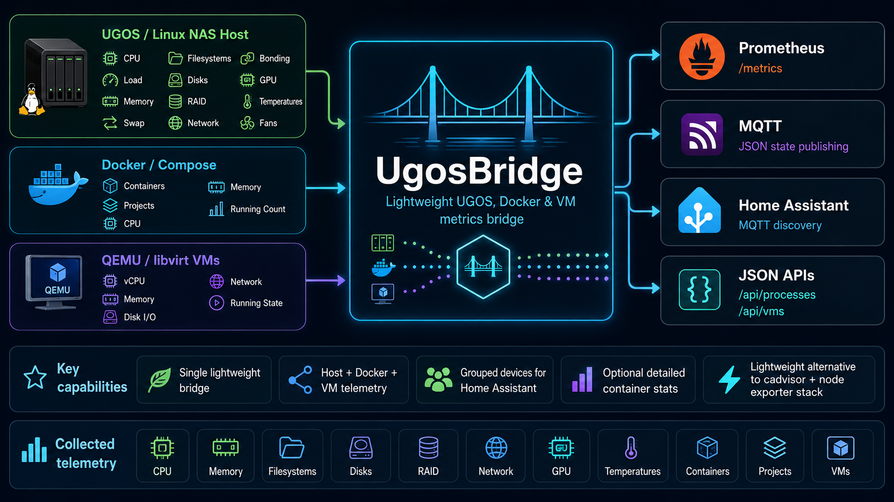

# Bridge

`ugos-bridge` is a lightweight telemetry bridge for UGOS / UGREEN NAS hosts,
Docker Compose stacks, and QEMU/libvirt virtual machines.

It collects Docker, host, storage, network, GPU, health, cooling, process, and
VM data, then exports it through:

- Prometheus at `/metrics`
- JSON APIs at `/api/processes` and `/api/vms`
- MQTT state topics
- Home Assistant MQTT discovery



Published images: `rcooler/ugos-bridge` and the compatibility alias
`rcooler/ugos-exporter`, for Linux amd64 and arm64. Use a release version for a
fixed deployment or `latest` for the newest stable release.

## Documentation

- [Documentation index](docs/index.md)
- [Data collection and configuration](docs/data-collection.md)
- [UGOS Pro 1.19+ rootfs limitation](docs/data-collection.md#ugos-pro-119-and-later)
- [Prometheus metrics](docs/prometheus.md)
- [MQTT and Home Assistant discovery](docs/home-assistant.md)
- [Development and releases](docs/development.md)

## Minimal Run

Docker-only mode:

```bash
docker run -d \
  --name ugos-bridge \
  -p 9877:9877 \
  -v /var/run/docker.sock:/var/run/docker.sock:ro \
  rcooler/ugos-bridge:latest
```

For host telemetry, review the mounts and settings in
[data collection](docs/data-collection.md) and the
[Compose example](docker-compose.example.yml). That example builds from this
checkout and enables host telemetry and MQTT; edit it for your host and broker
before starting it. CLI flags and their defaults are listed by `ugos-bridge --help`.

The Docker socket grants host-root-equivalent API access even with a read-only
bind mount. Keep the unauthenticated HTTP endpoint on a trusted network.

`/healthz` checks process liveness, not successful telemetry collection. Monitor
`ugos_bridge_up` and collection timestamps as described in the
[Prometheus guide](docs/prometheus.md#bridge-health).

Home Assistant dashboards are a separate component: see
[HA cards](../ha-cards/README.md).

## Legal

UgosBridge is an unofficial DIY open-source project. It is not affiliated with,
endorsed by, or sponsored by UGREEN. UGREEN, UGOS, and related product names are
trademarks or registered trademarks of their respective owners and are referenced
only to describe compatibility and integration.
